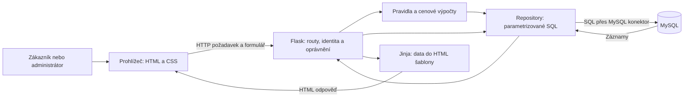
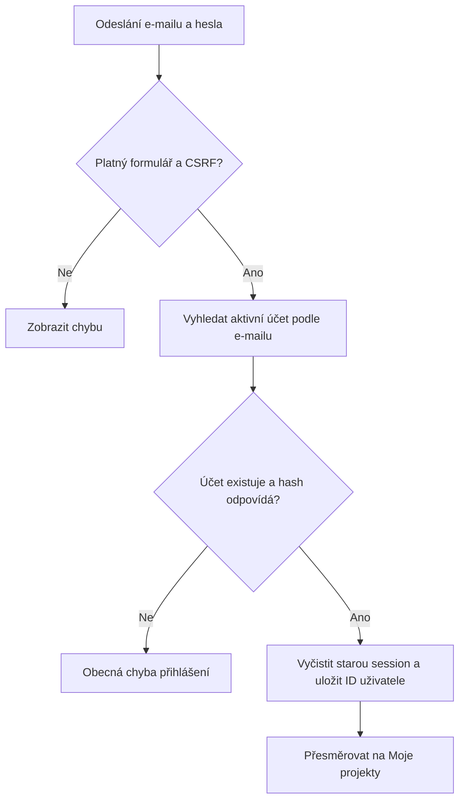
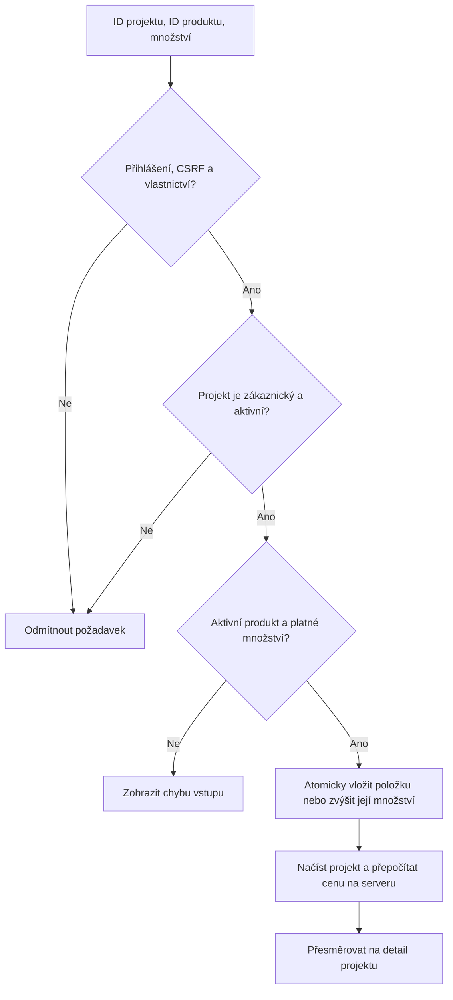
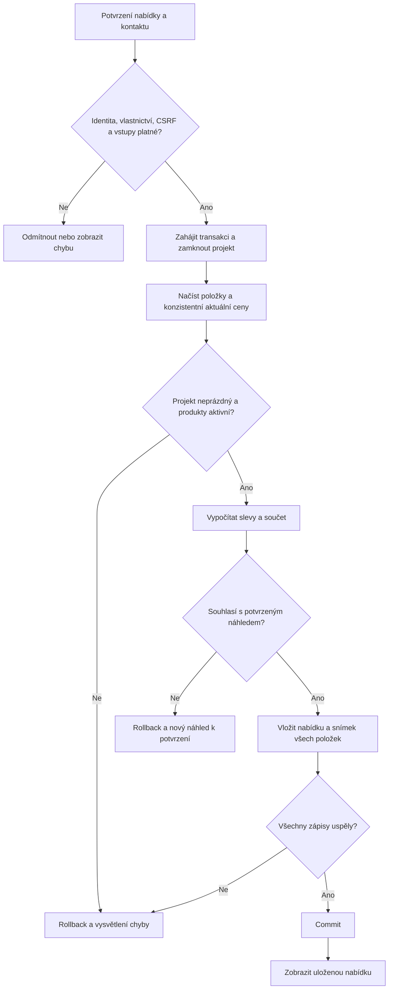

# Datové toky

## Celková architektura

Prohlížeč se k MySQL nepřipojuje. Heslo databáze zná jen server. Formulář odešle například ID produktu a množství; cenu, slevu a vlastníka určuje server, nikoliv zákazníkem poslaná hodnota.

| Událost | Odkud data přicházejí | Zpracování | Čtení / zápis |
|---|---|---|---|
| Filtrace katalogu | Parametry URL | Povolené filtry, parametrizovaný dotaz, povolené hodnoty řazení | `products`, `categories`, `tags`, `product_tags` |
| Registrace | Formulář | Validace, hash hesla, kontrola unikátního e-mailu | Zápis `users` |
| Přihlášení | Formulář | Ověření hashe, založení přihlašovací session | Čtení `users` |
| Nový projekt | Formulář a přihlášený účet | Vlastníka nastaví server | Zápis `projects` |
| Použití sestavy | ID veřejné šablony | Ověření šablony, transakční kopie projektu a položek | Čtení šablony, zápis `projects`, `project_items` |
| Změna množství | Formulář | Vlastnictví, CSRF, celé kladné množství, aktivní produkt | Zápis `project_items` |
| Průběžná cena | Položky a aktuální katalog | Pravidla slev, výpočet přes `Decimal` | Čtení položek a produktů |
| Vytvoření nabídky | Potvrzený formulář | Transakční cenový snímek a kontaktní údaje | Zápis `quotes`, `quote_items` |
| Vyřízení nabídky | Admin formulář | Kontrola role a povolené změny stavu | Aktualizace `quotes.status` |

Více zvolených filtrů se kombinuje pomocí AND. Pro první verzi musí produkt splňovat všechny zvolené tagy. Hodnoty filtrů se předávají SQL jako parametry; názvy sloupců pro řazení se vybírají pouze ze serverového seznamu.

## Diagram 1: přihlášení

Do DB ukládáme hash hesla, nikdy původní heslo. Do session nepatří heslo ani firemní údaje. Při dalších požadavcích ověříme aktuální roli a aktivitu účtu v DB.

## Diagram 2: přidání produktu do projektu

Stejný produkt má v jednom projektu jediný řádek. Přidání množství je jiné než editace: přidání počet zvýší, změna množství jej nahradí. Odstranění má vlastní akci; nula se neukládá.

## Diagram 3: vytvoření cenové nabídky

Transakce znamená „buď všechno, nebo nic“: nesmí vzniknout hlavička nabídky bez položek. Při implementaci budou také změny položek zamykat rodičovský projekt, aby během finalizace nevznikl smíšený stav. Unikátní token potvrzení zabrání vytvoření dvou nabídek dvojklikem; token vlastníka ani CSRF nenahrazuje. Nová vědomá finalizace smí vytvořit další nabídku stejného projektu.

GET požadavky jen čtou. Vytvoření, změny, odstranění i odhlášení používají POST s CSRF ochranou. Po úspěšném POST následuje přesměrování. Skrytí tlačítka v HTML není kontrola oprávnění; tu vždy provede server.

## Budoucí rozšíření

PDF bude vznikat z uložené nabídky, nikoliv z aktuálního katalogu. E-mail se bude odesílat až po úspěšném commitu. Selhání e-mailu nezruší uloženou nabídku a půjde jej opakovat.

## Navržené testy pro další fázi

1. Hranice slev: 9, 10, 19, 20 kusů a zaokrouhlení částek.
2. Přístup k cizímu projektu nebo nabídce je odmítnut.
3. Změna katalogové ceny nezmění již uloženou nabídku.
4. Selhání při zápisu položky vrátí celou transakci; opakovaný token nevytvoří další nabídku.
