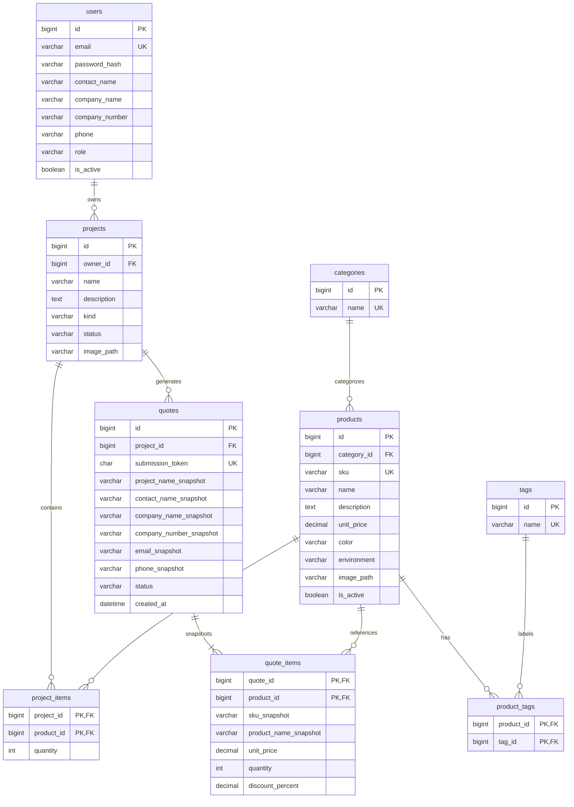

# Databáze a ER diagram

První návrh používá 9 tabulek. Implementace DDL je v `sql/001_schema.sql`. SQL cílí na **MySQL 8.0.16 a novější**, kde jsou vynucována použitá CHECK omezení. Konkrétní školní prostředí ještě není ověřeno.

## ER diagram

Diagram je zapsán v Mermaid a lze jej zobrazit například v náhledu Markdown podporujícím Mermaid. Datové typy a úplná omezení jsou v SQL souboru; diagram ukazuje klíče a hlavní údaje.

`||` znamená právě jeden, `o{` nula až mnoho, `|{` jeden až mnoho. Nabídka musí z obchodního hlediska mít alespoň jednu položku; samotný FK to nevynutí, proto vznikne společnou transakcí s položkami.

## Proč jednotlivé tabulky existují

| Tabulka | Účel a rozhodnutí |
|---|---|
| `users` | Účet, kontakt a role. E-mail je unikátní; před uložením jej aplikace normalizuje. IČO není číslo pro výpočty, proto VARCHAR; není unikátní, protože více kontaktů může být ze stejné firmy. |
| `categories` | Jedna hlavní kategorie na produkt; její název neopakujeme u každého produktu. |
| `products` | Aktuální katalog a cena. Barva je jednotně zadávaný text, prostředí je pevná volba. V první verzi produkt má jednu základní barvu. |
| `tags` | Volné vlastnosti jako „stohovatelné“, „kavárna“, „minimalistické“. Kategorie, barva a prostředí se neduplikují do tagů. |
| `product_tags` | Vazba M:N. Jeden produkt má více tagů a tag patří více produktům. Složený PK zabraňuje duplicitnímu tagu produktu. |
| `projects` | Rozpracované projekty i šablony. Vlastníkem šablony je admin; šablony smí zveřejňovat pouze admin. Archivovaná šablona není nabízena. |
| `project_items` | Vazba M:N mezi projekty a produkty s množstvím. Složený PK zajistí jeden řádek produktu v projektu. |
| `quotes` | Hlavička cenového snímku. Uchovává tehdejší název projektu a kontakt, aby pozdější úprava profilu nezměnila historii. |
| `quote_items` | Tehdejší název, SKU, jednotková cena, množství a sleva. Odkaz na produkt zůstává pro dohledání, cena se však čte ze snímku. |

Ukázka: projekt „Kavárna Centrum“ obsahuje 12 stejných židlí a 4 stoly. V `project_items` jsou jen dva řádky. Při ceně židle 1 000 Kč a stolu 3 000 Kč je řádek židlí po 5% slevě 11 400 Kč; stoly 12 000 Kč. Nabídka je 23 400 Kč bez DPH. Změna ceny židle v katalogu na 1 100 Kč ovlivní rozpracovaný projekt, ale nikoliv tuto nabídku.

## Klíče, omezení a životní cyklus

- PK jednoznačně označuje záznam; FK zaručuje existenci odkazovaného záznamu.
- UNIQUE chrání například SKU a e-mail. NOT NULL vyznačuje povinné údaje.
- `DECIMAL(12,2)` ukládá přesné peněžní hodnoty; FLOAT pro ceny nepoužijeme.
- Produkty i účty lze deaktivovat. Historické produkty odkazované nabídkami nelze fyzicky odstranit.
- Projekt s nabídkou nelze smazat díky `ON DELETE RESTRICT`; lze jej archivovat. Prázdný nebo rozpracovaný projekt bez nabídky odstranit lze a jeho položky se smažou kaskádou.
- Smazání vazby produktu a tagu nesmaže ani produkt, ani tag.
- Nabídka začíná jako `new`, admin ji označí `contacted` a následně `closed`. Obsah a ceny hotové nabídky se neupravují; opravou je nová nabídka.
- Databáze sama nekontroluje role, vlastnictví, zákaz úprav snímků ani přítomnost všech položek. To jsou pravidla aplikační vrstvy, která ověří testy.
- Součet ani řádkové mezisoučty neukládáme: odvodíme je ze zachycených cen, množství a slev. Nevzniknou tak dvě navzájem rozporné částky.

## Normalizace a BCNF

BCNF znamená, že determinant každé netriviální funkční závislosti je superklíč. Nestačí pouze mít číselné ID; záleží na pravidlech významu dat.

Za uvedených předpokladů:

| Relace | Kandidátní klíče a závislosti |
|---|---|
| `users` | `id` nebo `email` určují ostatní údaje účtu. Firemní údaje jsou údaje zadané konkrétním kontaktem, nikoliv centrální firemní registr. |
| `categories`, `tags` | `id` nebo unikátní `name` určují celý záznam. |
| `products` | `id` nebo `sku` určují údaje produktu. Název kategorie je pouze v `categories`. |
| `product_tags` | Celá dvojice `(product_id, tag_id)` je klíč; jiné atributy nejsou. |
| `projects` | `id` určuje záznam. Jméno vlastníka zde není. |
| `project_items` | Dvojice `(project_id, product_id)` určuje množství. Cena a název produktu zde nejsou. |
| `quotes` | `id` nebo `submission_token` určují snímek. `project_id` není klíč: projekt smí mít více nabídek. |
| `quote_items` | Dvojice `(quote_id, product_id)` určuje historické údaje řádku. Samotné `product_id` neurčuje historickou cenu ani historický název napříč nabídkami. |

Slevu uchováváme jako schválenou historickou hodnotu; budoucí pravidla se mohou změnit. Proto množství samo o sobě neurčuje slevu napříč celou tabulkou historických nabídek. Stejně tak kontaktní e-mail neurčuje historický název firmy pro všechny nabídky v čase.

Za těchto předpokladů návrh odpovídá BCNF. Pokud přidáme sdílené firmy nebo začneme vynucovat závislost IČO → název firmy, bude potřeba samostatná tabulka firem. Normalizaci znovu ověříme při změně pravidel.

## Navazující práce

V této etapě vzniká návrh a CREATE TABLE skript. INSERT data, ukázky JOIN / WHERE / ORDER BY / GROUP BY / LIKE, UPDATE a DELETE přidáme následně. SQL zatím nebylo spuštěno proti skutečnému MySQL serveru; nelze jej označit za integračně ověřené.
